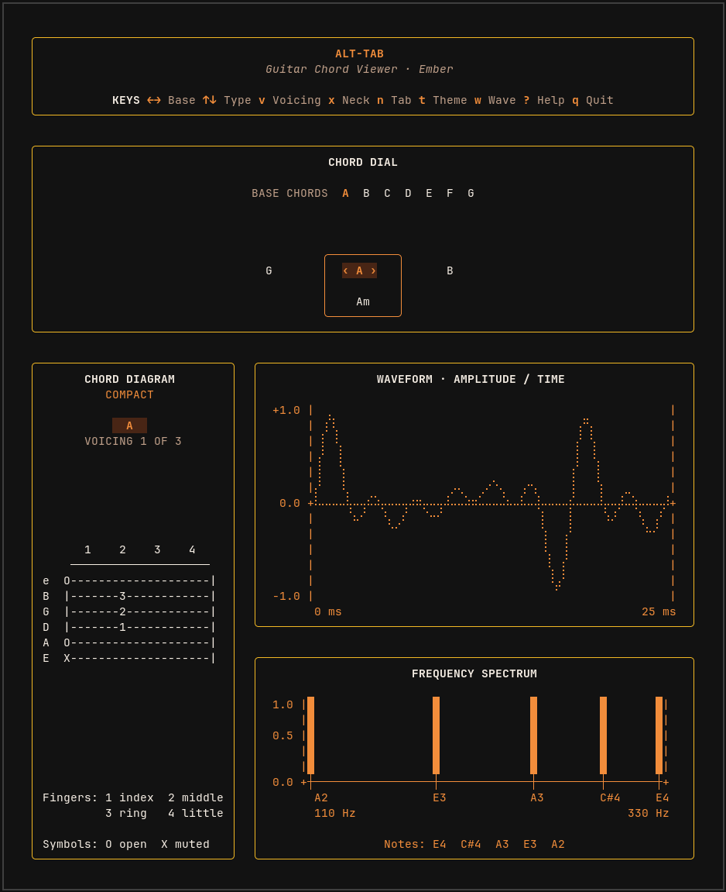

# Alt-Tab

[](https://github.com/jake-mckenzie/alt-tab/actions/workflows/ci.yml)

A terminal guitar chord viewer built with Go and Bubble Tea. Browse chord
shapes and see the notes that make them up, with waveform and spectrum views.
Starts in Ember; press `t` once for Neon Dark: near-black, neon green, cyan,
and purple accents.

This is the `master` branch. For the desktop version with audio playback, use
`raylib`. [Branch notes](docs/branches.md).



## Run it

You’ll need Go 1.25+ and Make.

```bash
git clone --branch master https://github.com/jake-mckenzie/alt-tab.git
cd alt-tab
make run
```

Use a terminal at least 80 columns wide, or 98 for the full-neck view.

## Controls

| Key | Action |
| --- | --- |
| `←` / `h`, `→` / `l` | Previous / next chord |
| `↑` / `k`, `↓` / `j` | Move between available accidental, major, and minor chords |
| `v` | Next voicing |
| `x` | Toggle compact / full-neck view |
| `n` | Toggle finger numbers / fret numbers |
| `t` | Next theme |
| `w` | Show / hide waveform |
| `?` | Toggle help |
| `Esc` | Close help |
| Mouse wheel | Scroll |
| `q` / `Ctrl+C` | Quit |

## Chords

Three voicings each for **A, Am, B, Bb, C, Cm, D, Dm, E, Em, F, F#, G, and Gm**.

Diagrams put high e at the top and low E at the bottom. `O` means open, `X`
means muted, and finger numbers run from 1 (index) to 4 (little finger).
Full-neck view shows frets 1–27; fret-number view uses the compact layout.

<details>
<summary>Terminal preview</summary>

<!-- BEGIN VERIFIED TUI OUTPUT -->
```text
  ╭──────────────────────────────────────────────────────────────────────────╮
  │                                 ALT-TAB                                  │
  │                       Guitar Chord Viewer · Ember                        │
  │                                                                          │
  │ KEYS ←→ Base ↑↓ Type v Voicing x Neck n Tab t Theme w Wave ? Help q Quit │
  ╰──────────────────────────────────────────────────────────────────────────╯

  ╭──────────────────────────────────────────────────────────────────────────╮
  │                                CHORD DIAL                                │
  │                                                                          │
  │                     BASE CHORDS  A  B  C  D  E  F  G                     │
  │                                                                          │
  │                                                                          │
  │                                                                          │
  │                               ╭──────────╮                               │
  │                       G       │  ‹ A ›   │      B                        │
  │                               │          │                               │
  │                               │    Am    │                               │
  │                               ╰──────────╯                               │
  ╰──────────────────────────────────────────────────────────────────────────╯

  ╭────────────────────────────╮  ╭──────────────────────────────────────────╮
  │       CHORD DIAGRAM        │  │       WAVEFORM · AMPLITUDE / TIME        │
  │          COMPACT           │  │                                          │
  │                            │  │  +1.0 |                               |  │
  │             A              │  │       | ⣷                     ⡼⡀      |  │
  │       VOICING 1 OF 3       │  │       |⢰⠉⡆                    ⡇⡇      |  │
  │                            │  │       |⢸ ⡇                   ⢸ ⢇      |  │
  │                            │  │       |⢸ ⢱                   ⢸ ⢸      |  │
  │                            │  │       |⡇ ⢸         ⡤⡀⢀⠎⡆ ⡰⡄  ⢸ ⠸⡀ ⡀   |  │
  │                            │  │   0.0 +⠧⠤⠬⡦⡴⠵⡤⠤⡴⢦⠤⡼⠤⠵⠮⠤⠼⠴⠥⢵⠤⠤⡧⠤⠤⡧⡴⠽⡤⠤⡼+  │
  │                            │  │       |   ⠱⠃ ⢇⢰⠁ ⠓⠁       ⢸  ⡇  ⠱⠃ ⢣⢠⠃|  │
  │                            │  │       |      ⠈⠁           ⠈⡆ ⡇     ⠈⠊ |  │
  │       1    2    3    4     │  │       |                    ⡇⢰⠁        |  │
  │     ────────────────────   │  │       |                    ⢱⢸         |  │
  │ e  O--------------------|  │  │       |                    ⠸⡜         |  │
  │ B  |-------3------------|  │  │  -1.0 |                     ⠁         |  │
  │ G  |-------2------------|  │  │        0 ms                       25 ms  │
  │ D  |-------1------------|  │  ╰──────────────────────────────────────────╯
  │ A  O--------------------|  │
  │ E  X--------------------|  │  ╭──────────────────────────────────────────╮
  │                            │  │            FREQUENCY SPECTRUM            │
  │                            │  │                                          │
  │                            │  │  1.0 |█          █       █     █    █|   │
  │                            │  │      |█          █       █     █    █|   │
  │                            │  │  0.5 |█          █       █     █    █|   │
  │                            │  │      |█          █       █     █    █|   │
  │                            │  │      |█          █       █     █    █|   │
  │                            │  │  0.0 +┼──────────┼───────┼─────┼────┼+   │
  │ Fingers: 1 index  2 middle │  │        A2        E3      A3    C#4  E4   │
  │          3 ring   4 little │  │        110 Hz                   330 Hz   │
  │                            │  │                                          │
  │ Symbols: O open  X muted   │  │        Notes: E4  C#4  A3  E3  A2        │
  ╰────────────────────────────╯  ╰──────────────────────────────────────────╯
```
<!-- END VERIFIED TUI OUTPUT -->

</details>

## Development

| Command | Purpose |
| --- | --- |
| `make` | Build `bin/alt-tab` |
| `make BUILD=release` | Build a smaller release binary |
| `make test` | Run tests |
| `make check` | Run formatting, tests, race checks, and vet |
| `make clean` | Remove build output |

The race check requires cgo and a C compiler; normal builds and tests don’t.

`cmd/alt-tab` starts the app, `internal/tui` handles the interface, and
`internal/chords` holds the chord catalog.
