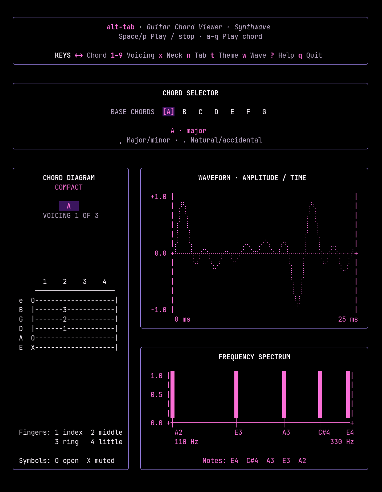

# alt-tab

[](https://github.com/jake-mckenzie/alt-tab/actions/workflows/ci.yml)

A terminal guitar chord viewer built with Go and Bubble Tea. Browse voicings,
play chords, and explore their notes with waveform and frequency spectrum views.



## Install

Prebuilt releases support Linux and macOS on x86_64 and ARM64:

```sh
curl -fsSL https://raw.githubusercontent.com/jake-mckenzie/alt-tab/master/install.sh | sh
alt-tab
```

The installer requires a published GitHub Release. It verifies the release's
SHA-256 checksum and installs to `~/.local/bin` without sudo. Ensure that directory
is on your `PATH`. Run the same command to update; remove `~/.local/bin/alt-tab`
to uninstall. Installer options: `--version vX.Y.Z`, `--dir PATH`, and `--run`.

### Build from source

Requires Go 1.25+:

```sh
git clone https://github.com/jake-mckenzie/alt-tab.git
cd alt-tab
go mod download
go run ./cmd/alt-tab
```

Use a terminal at least 80 columns wide, or 98 for the full-neck view.

## Controls

| Key | Action |
| --- | --- |
| `←` / `h`, `→` / `l` | Previous / next base chord |
| `,` | Swap major / minor where available |
| `.` | Swap natural / accidental where available |
| `1`–`9` | Select a voicing; unavailable numbers do nothing |
| `Space` / `p` | Play / stop |
| `a`–`g` | Select and play a chord |
| `x` | Toggle compact / full-neck view |
| `n` | Toggle finger numbers / fret numbers |
| `t` | Cycle themes |
| `w` | Show / hide waveform |
| `?` | Toggle help |
| `Esc` | Close help |
| Mouse wheel | Scroll |
| `q` / `Ctrl+C` | Quit |

In terminals that report key releases, hold `a`–`g` to play and release to stop.
Other terminals toggle playback for that chord. `Space` / `p` works in either case.
The initial theme is Ember; press `t` once for Neon Dark.

## Audio

Playback currently supports Linux with PulseAudio or PipeWire's PulseAudio
service. Synthesis and output are written in Go, with no cgo or external player
required. Navigation updates the playing chord; opening help, losing focus
(where the terminal reports it), or quitting stops playback.

If audio is unavailable, the app still supports browsing and displays
`Audio unavailable`. Native macOS and Windows audio support is planned.

## Chords

Three voicings each for **A, Am, B, Bb, C, Cm, D, Dm, E, Em, F, F#, G, and Gm**.

Diagrams show high e at the top and low E at the bottom. `O` means open and `X`
means muted. Fingers are numbered 1 (index) through 4 (little finger). Full-neck
view covers frets 1–27; fret-number view uses the compact layout.

## Development

| Command | Purpose |
| --- | --- |
| `go build -o bin/alt-tab ./cmd/alt-tab` | Build the binary |
| `go run ./cmd/alt-tab` | Run directly |
| `go test ./...` | Run tests |
| `go test -race ./...` | Run tests with race detection |
| `go vet ./...` | Check for likely mistakes |
| `gofmt -w cmd internal` | Format Go source |

For a smaller release binary:

```sh
CGO_ENABLED=0 go build -trimpath -ldflags="-s -w" -o bin/alt-tab ./cmd/alt-tab
```

Only the race check requires cgo and a C compiler.

`cmd/alt-tab` starts the app. Under `internal/`, `tui` handles the terminal UI,
`chords` holds the catalog, `signal` provides pitch calculations for audio and
plots, and `audio` handles synthesis and platform output. Future audio backends
can reuse the synthesizer without changing the UI.
