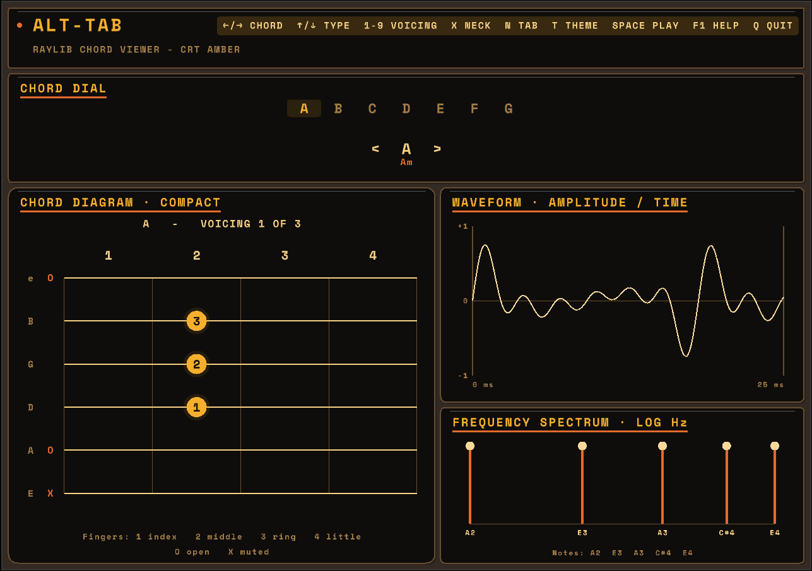

# Alt-Tab

[](https://github.com/jake-mckenzie/alt-tab/actions/workflows/ci.yml)

A guitar chord viewer built with Go and Raylib. Browse chord shapes, hear them
played back, and see their waveforms and frequency spectra.

This is the `raylib` branch. The original terminal version is on `master`.
[Branch notes](docs/branches.md).



*The screenshot uses the old neck shortcut; it’s now `x`.*

## Run it

You’ll need Go 1.25+, Make, and a C compiler with cgo enabled. On Linux, install
the OpenGL, X11, and xkbcommon development libraries; on macOS, install Xcode
Command Line Tools. The Go module includes Raylib itself.

```bash
git clone --branch raylib https://github.com/jake-mckenzie/alt-tab.git
cd alt-tab
make run-raylib
```

For the terminal interface included in this branch, use `make run`.

## Controls

| Key | Action |
| --- | --- |
| `←` / `h`, `→` / `l` | Previous / next chord |
| `↑` / `k`, `↓` / `j` | Move between available accidental, major, and minor chords |
| `v` | Next voicing |
| `1`–`9` (also numpad) | Select a voicing; unavailable numbers do nothing |
| `x` | Toggle compact / full-neck view |
| `n` | Toggle finger numbers / fret numbers |
| `t` | Next theme |
| `a`–`g` | Select and play a chord |
| `Space` / `p` | Play / stop |
| `F1` / `?` | Toggle help |
| `q` / `Esc` | Quit (`Esc` closes help first) |

In the terminal interface, use `?` for help, `w` to toggle the waveform, and
`q` or `Ctrl+C` to quit. The mouse wheel scrolls; `Esc` closes help.

## Chords

Three voicings each for **A, Am, B, Bb, C, Cm, D, Dm, E, Em, F, F#, G, and Gm**.

Diagrams put high e at the top and low E at the bottom. `O` means open, `X`
means muted, and finger numbers run from 1 (index) to 4 (little finger).
Full-neck view shows frets 1–27; fret-number view uses the compact layout.
Changing chords keeps your voicing number, or returns to 1 if it isn’t available.

## Development

| Command | Purpose |
| --- | --- |
| `make build-raylib` | Build `bin/alt-tab-raylib` |
| `make BUILD=release build-raylib` | Build a smaller release binary |
| `make test` | Run the Go tests without graphics dependencies |
| `make check` | Run formatting, Go and Raylib tests, race checks, and vet |
| `make clean` | Remove build output |

`make check` needs the same graphics dependencies as the desktop build.

The interfaces live in `internal/rayui` and `internal/tui`. They share the chord
catalog (`internal/chords`), navigation (`internal/app`), and pitch calculations
(`internal/signal`). Entry points are in `cmd/`.

The bundled Space Mono Bold font uses the [SIL Open Font License](internal/rayui/assets/OFL.txt).
